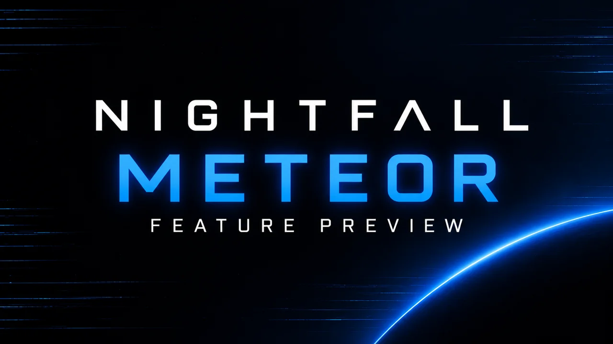

<div align="center">


# Nightfall

**An open-source VR streaming suite for Meta Quest.**

Stream your desktop and PC VR games, browse the web without a PC, and turn
ordinary games and videos into stereoscopic 3D. Nightfall runs on your headset;
Meteor brings host-side depth processing, desktop hosting, and XR streaming
to your PC.

[](https://github.com/tB0nE/nightfall/stargazers)
[](LICENSE)
[](https://github.com/tB0nE/nightfall/releases/latest)

[Features](#features) · [Getting started](#usage-and-requirements) · [Compatibility](#compatibility) · [Roadmap](#roadmap) · [Building](#building) · [Support](#reporting-problems) · [Donate](#donate)

[Stable release](https://github.com/tB0nE/nightfall/releases/latest) · [0.9.0 feature preview](https://github.com/tB0nE/nightfall/releases/tag/v0.9.0-preview.1)

[](https://www.youtube.com/watch?v=jI8_UnwjWMw)

**[Watch the feature preview](https://www.youtube.com/watch?v=jI8_UnwjWMw)** — desktop streaming, AI 3D, the browser, PC VR, and multiple screens.

</div>

> [!NOTE]
> This README describes current development. The browser, multiple-screen,
> managed-host, and Meteor PC VR features are preview work, and are not all
> available in the latest stable release. Check each release's notes for its
> platforms, included features, and known issues; newer development fixes may
> not yet be in the published preview.

## Nightfall and Meteor

**Meteor is optional.** Nightfall connects directly to Sunshine, Apollo,
Vibepollo, Polaris, and other compatible GameStream hosts for desktop and game
streaming, including on-headset AI 3D. You can keep your existing host.

**[Meteor](meteor/README.md)** is the PC companion required for Nightfall's
PC VR streaming, multiple desktop-monitor streams, host-generated depth maps,
and headset microphone passthrough. It can work alongside an existing compatible
host or install and manage our Nightfall-focused Vibepollo build.

**The standalone browser does not require Meteor or a PC.** Browser screens
and multiple desktop-monitor streams are separate capabilities.

## Features

### Streaming and screens

- **Desktop and game streaming** — broad GameStream host compatibility, with
  configurable resolution, refresh rate, bitrate, and codec.
- **PC VR streaming through Meteor (preview)** — launch a supported XR game
  from your desktop stream and switch into VR. A wristwatch brings back the
  desktop workspace or PCVR settings; leaving the game returns to the desktop.
- **Standalone browser (preview)** — browse, watch videos, or try browser-based
  gaming without a PC. Includes tabs, bookmarks, optional history, ad/tracker
  blocking, virtual-keyboard input, and gamepad support. Website, DRM, and
  service compatibility varies.
- **Multiple screens (preview)** — combine desktop monitors and browser screens
  in one workspace, with up to four screens and tabs within each browser.
  Multiple desktop-monitor streams require Meteor and a compatible host;
  additional desktop monitors must exist physically or as host-provided virtual
  displays. Browser screens do not require a host.
- **Managed desktop host (preview)** — Meteor can download and manage
  Meteor-Vibepollo, with pairing and input-permission assistance. Existing
  Sunshine-compatible hosts remain supported.
- **USB Link** — stream over the Quest's USB-C cable instead of Wi-Fi, with
  Wi-Fi fallback when unplugged.

### 3D and display

- **AI stereoscopic 3D** — estimate depth from ordinary 2D games and video,
  locally on Quest using EdgePad or on your PC using Meteor. Host-side choices
  include EdgePad and the temporal Video Depth Anything model. On-headset
  inference applies to the primary screen; Meteor can separately provide depth
  for the desktop stream.
- **SBS support** — Stretch and Crop modes for native side-by-side content.
- **VR-native display controls** — grab, reposition, resize, curve, and recenter
  screens, with an independently controlled bezel, picture controls,
  passthrough, and ambient lighting.
- **HDR streaming** — HDR10/PQ and HLG streams are tone mapped on Quest.
- **PyroWave** — an additional GPU-decoded codec for high bitrates on fast local
  networks, when supported by the host.

AI 3D uses **estimated depth**, rather than native stereo camera views. Fine
edges, text, occluded areas, and motion can produce artifacts. Separation and
convergence let you adjust the effect; the final depthmap view helps inspect
what is driving it. GPU and network performance determine usable update rates.

### Input and accessibility

- **Controller mapping** — gamepad layouts and mouse/keyboard mapping for
  Quest controllers, plus connected-gamepad support.
- **Virtual keyboard and trackpad** — type, use desktop shortcuts, and control
  a relative mouse from a floating VR panel.
- **Hand tracking** — navigate and interact without controllers on supported
  Meta Quest headsets.
- **Microphone passthrough through Meteor** — use the headset microphone as a
  PC input device.
- **21 languages** — translated menus with an in-app language picker.

See the [controls guide](docs/guides/controls.md) for shortcuts, controller
layouts, and trackpad use.

## Why Nightfall

Nightfall is built around a configurable OpenXR display. The desktop lives in
3D space: grab it, curve it, resize it, or place it wherever you want. AI depth
conversion and native SBS rendering provide different ways to view content in
stereoscopic 3D.

Compatibility remains central. Use your existing Windows, macOS, or Linux
GameStream host, add Meteor when you want its extra features, or open the
standalone browser with no PC connection. Passthrough keeps your keyboard and
desk visible while you work.

The focus is a useful, customizable VR workspace and gaming experience, built
in the open. Linux is a particular focus; the aim is to make desktop and PC VR
streaming easier to use together.

## Roadmap

- Complete and validate Windows PC VR support and improve Windows installation.
- Broaden GPU, headset, and desktop compatibility testing, including modern AMD
  and Intel hardware, Quest 2/3S, and additional Wayland setups.
- Refine multiple-screen management, layouts, and desktop/browser/XR transitions.
- Harden installation, updates, pairing, reconnects, and headset standby recovery.
- Improve AI depth quality, edge alignment, and temporal stability; continue
  researching custom models.
- Continue improving hand tracking and controller/input behavior.
- Revisit 3D environments after the main release, with performance as a constraint.
- Continue maintaining the Linux Nightfall client alongside the Quest client.

These are development directions, not release-date commitments. Implementation
plans and research are indexed in [docs/README.md](docs/README.md).

## Compatibility

| Component | Current scope |
|---|---|
| **Nightfall on Quest** | Quest 2, Quest 3, and Quest 3S. Quest 3 receives the most testing; Quest 2 has less performance headroom. |
| **Existing desktop hosts** | Sunshine, Apollo, Vibepollo/Vibeshine, Polaris, and other compatible GameStream hosts. No Meteor requirement for ordinary desktop/game streaming or on-headset AI 3D. |
| **Meteor on Linux** | Host depth, microphone passthrough, managed desktop host, multiple desktop-monitor streams, and experimental PC VR. KDE Plasma X11 and Wayland have been tested; other desktops need wider coverage. |
| **Meteor on Windows** | Host depth and microphone support exist. Windows PC VR work is in development; check release notes for the features and downloads available in each build. |
| **Meteor depth backends** | EdgePad uses Vulkan on suitable NVIDIA, AMD, or Intel drivers, with CPU options. VDA has NVIDIA TensorRT and generic Vulkan paths; model availability and performance vary by platform and GPU. |
| **Meteor PC VR encoders** | NVIDIA/NVENC is the main tested path; AMD/VA-API is experimental. Codec, live-control, and foveation support depend on the encoder. |
| **Linux Nightfall client** | A separate AppImage client for compatible OpenXR runtimes. It is not the Meteor host; not every release includes a Linux client build. |

## Usage and Requirements

### Install Nightfall on Quest

1. Choose the [stable release](https://github.com/tB0nE/nightfall/releases/latest)
   or the [0.9.0 feature preview](https://github.com/tB0nE/nightfall/releases/tag/v0.9.0-preview.1).
2. Download the Android APK and sideload it with SideQuest, ADB, or
   [Obtainium](https://github.com/ImranR98/Obtainium). Install updates in place
   to retain your settings and pairings.
3. Launch Nightfall from **Unknown Sources** in the Quest app library.

### Use an existing GameStream host — no Meteor required

Supported hosts include:

- **[Sunshine](https://github.com/LizardByte/Sunshine)**
- **[Apollo](https://github.com/ClassicOldSong/Apollo)**
- **[Polaris](https://github.com/papi-ux/polaris)**
- **[Vibepollo](https://github.com/Nonary/Vibepollo) / Vibeshine**

1. Install and configure a compatible host on your PC. For Sunshine, its web
   interface normally uses `https://<your-pc-ip>:47990`.
2. Keep the PC and headset on the same local network. Select the discovered
   server in Nightfall, or enter its address using **Select Server**.
3. Press **Connect**. On first use, approve the displayed PIN through the host's
   pairing interface.
4. Start streaming. You can enable on-headset AI 3D without installing Meteor.

### Use the standalone browser — no PC required

In a build with browser support, select **Open Browser** from the welcome
screen. Open a website, add tabs, or add another browser screen. Enable AI 3D
on the primary screen if desired.

YouTube, local Plex, and Xbox Cloud Gaming have worked in testing. Each service
has its own browser requirements, content restrictions, and subscription terms;
working in a desktop browser does not guarantee compatibility here.

### Add Meteor for PC VR, multiple desktop monitors, host depth, or microphone

1. Download Meteor from the same release as Nightfall where possible, and run
   it on the host PC. For a Linux AppImage, make it executable first.
2. Keep your existing GameStream host, or follow Meteor's managed-host setup.
   Follow its pairing and input-permission prompts when applicable.
3. Nightfall discovers Meteor automatically; choose Meteor as the AI 3D source
   when you want host-generated depth. See [Meteor's guide](meteor/README.md)
   for model downloads, microphone configuration, and platform requirements.
4. For multiple desktop monitors, use the **Screens** settings with a compatible
   host. Meteor does not itself create extra physical monitors.
5. For Linux PC VR, enable **PCVR** in Meteor and follow its runtime setup.
   Meteor bundles its Monado-based runtime and xrizer; a separate WiVRn or
   SteamVR installation is not required for this path.
6. Use **Copy Steam Launch Options** in Meteor's tray menu and paste the copied
   command into each VR game's Steam launch options. Approve the headset when
   prompted, then launch the supported game from your desktop stream.
7. In XR, use the wristwatch to show/hide the desktop workspace or open PCVR
   settings. Quit the XR application to return to the desktop stream.

### Linux Nightfall client

The Linux **client** runs inside an OpenXR environment such as
[WiVRn](https://github.com/WiVRn/WiVRn) or another compatible Monado setup. It is
separate from installing Meteor on Linux to stream PC VR to Quest.

Download `Nightfall-Linux-*-x86_64.AppImage` from a release that includes it,
make it executable, and run it with your OpenXR runtime active. To build it,
follow [BUILD.md](BUILD.md) and run `./build.sh --appimage`.

The client supports desktop streaming, SBS, Vulkan ZipDepth inference, and
MiDaS/Depth Anything CPU alternatives. Passthrough depends on runtime support;
it does not use Android's native GLES renderer path.

## Reporting problems

Check the [issue tracker](https://github.com/tB0nE/nightfall/issues) for an
existing report. When opening an issue, include:

- Nightfall and Meteor versions, and whether you are using a preview/dev build.
- Headset model, host GPU/driver, host software, and operating system.
- On Linux, your desktop environment and whether you are using X11 or Wayland.
- Steps to reproduce, including screen layout and whether desktop, browser,
  AI 3D, or PC VR was active.
- A diagnostic log exported using Nightfall's **Download Log** button in the
  menu's top bar.

Logs are saved under `Download/Nightfall` on the headset and include the
current and previous app sessions, so you can export after reopening the app
following a crash. Review reports before sharing them publicly: host names and
network addresses may be included.

## Building

See [BUILD.md](BUILD.md) for full build instructions including:

- GDExtension compilation (cmake + ninja, not manual clang++)
- vcpkg dependency setup
- Android APK export via Godot headless
- Linux binary and AppImage export
- Quest deployment via ADB

Nightfall Meteor (the PC companion) is a separate Rust project; see
[meteor/README.md](meteor/README.md) for building it and its Linux AppImage and
Windows installer.

Architecture notes, active plans, research, and historical implementation
documents are indexed in [docs/README.md](docs/README.md).

Quick start (Android):

```bash
# Optimized APK
./build.sh --release

# Optimized APK and install to a connected headset
./build.sh --release --install
```

Quick start (Linux AppImage):

```bash
./build.sh --appimage
```

> [!WARNING]
> Quest release builds require Nightfall's patched Godot Android templates and
> matching native-XR bindings. Follow [BUILD.md](BUILD.md) before building from
> a fresh checkout. Do not compile either GDExtension manually with `clang++`.


## AI-assisted development

Nightfall is developed with substantial assistance from AI coding tools,
alongside automated checks and testing on real hardware. Project direction
and responsibility remain with the maintainer. Preview builds are experimental;
reproducible reports, logs, and contributions help improve reliability.

## Donate

Nightfall is a spare-time project built to make VR streaming more useful and
accessible. If it becomes part of your setup, that alone makes my day.
Donations help keep the coffee flowing and the commits coming.

[](https://github.com/sponsors/tB0nE)
[](https://ko-fi.com/tb0ne)

## License

Nightfall is licensed under the **GNU General Public License v3.0**. See [LICENSE](LICENSE) for the full text.
The EdgePad depth models are MIT-licensed, derived from
[ZipDepth](https://github.com/fabiotosi92/ZipDepth); Settings → Licences in the
app lists all third-party software and its licences.

Special thanks to the [Moonlight-Godot](https://github.com/html5syt/Moonlight-Godot) project, which served as a reference implementation, and to [Janyger](https://github.com/Janyger) for AI 3D contributions to Artemis. Compatible with
[Apollo](https://github.com/ClassicOldSong/Apollo), [Sunshine](https://github.com/LizardByte/Sunshine), and [Polaris](https://github.com/papi-ux/polaris).
