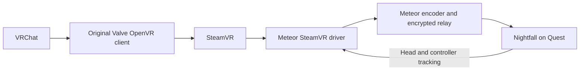

# Historical Windows VRChat investigation

This is the chronological investigation record. Interim failures and pending
checks are superseded by the [current compatibility status](../plans/active/meteor-windows-vrchat-compat.md).

# Windows VRChat compatibility research

Date: 2026-11-04. Optional backend prototype in development; not packaged.
Related: [Windows status](../plans/active/meteor-windows.md), [host architecture](../plans/active/meteor-host.md).

Latest user decision: defer direct xrizer/EAC acceptance and make the Windows
SteamVR route work properly. Direct-mode capture now replaces mirror sampling
by default: shared eye textures, bounds and the submitted layer's head pose
stay together through GPU packing, NVENC and Meteor's existing transport.
SteamVR's keyed synchronization texture guards access. The mirror backend is
retained only as an explicitly selected diagnostic.

Local acceptance on 2026-11-04:

- Corrected the OpenVR vertical projection convention: `top = tan(down)` and
  `bottom = tan(up)`. The former mapping inverted the asymmetric vertical FOV.
- Geometry unit executable passes 605 moving-head cases, including canted eyes,
  asymmetric FOVs, matrix/quaternion conversion and invalid-pose rejection.
- Encoded moving-scene validation passes 56 landmarks over 0.501 radians of
  head rotation, with maximum normalized image error 0.001501 (0.15%). A
  deliberately mismatched 40-frame metadata offset fails at 13.68% error.
  The initial two-second loading-grid fade is excluded. Evidence:
  `meteor/target/windows-steamvr-motion/20261104-204934-264/summary.json` and
  `negative-control.json`. This checks geometry, not motion-to-photon latency.
- Protected VRChat passes a 20-second local direct-mode capture/cleanup test
  with moving synthetic tracking (session `1793825498693736200`). The driver
  logged 1,320 frames before bounded cancellation; this is not a clean-END test.
- A separate scene application's natural exit passes with 112 validated frames
  and acknowledged END. All 148 Windows Release unit tests pass (19 ignored).

Quest trial `1793825805638655500` on 2026-11-04: the user reports the image
looked great; the earlier severe warping was not reported. Full controller
acceptance remains pending. At the deliberate 1024-per-eye, 72 Hz, 32 Mbps
profile, 4,454 frames arrived and decoded, 4,218 were projected: approximately
71.42 received and 67.66 projected frames/s over the observed interval, with no
decoder error. The timed cancellation interrupted frame delivery and wrote a
failure marker; it did not acknowledge END. Do not report graceful shutdown
acceptance for this run. Evidence:
`meteor/target/windows-steamvr-headset-1793825805638655500-summary.json`.

User feedback: resolution was low and no sound was heard. Resolution was an
explicit diagnostic override, not the negotiated client default. The standalone
XR trial has no separate audio lane; the current client preserves captured
desktop-host audio only while an existing desktop stream remains connected
(`src/pcvr_workspace_handover.gd`). Audio diagnosis after the trial: the active Quest speaker's `STREAM_MUSIC`
volume was **0**, while AAudio reported nonzero decoded/output levels and zero
write failures. Windows' default USB speaker endpoint was unmuted at 2% volume,
and Vibepollo was capturing that same endpoint at 48 kHz stereo. Raise Quest
media volume for the next test; do not infer a missing transport from silence.
A read-only `meteor-audio-probe` target reports endpoint defaults, mute/volume,
peak meters and per-process sessions without changing audio configuration.
Local Release capture now passes at 2048×2048 per eye (4096×2048 stereo),
64 Mbps, requested 72 Hz, five-second scene observation, with owned-process
cleanup. Evidence: `meteor/target/windows-steamvr-highres-summary.json`.
Headset presentation at this resolution still needs testing. The driver now
queries NVENC H.264 width/height capabilities and rejects oversized requests
explicitly rather than silently scaling the client's selection. Larger client
recommendations may need HEVC support; this backend is currently H.264 only.

NVIDIA/NVENC only at present. High-resolution codec limits and independently
posed composition layers remain limitations. Differently posed layers fail
explicitly rather than being silently composited with incorrect geometry.

## Recommendation

Keep Monado/xrizer for the games already working, including Moss. Prototype an
**optional Windows SteamVR driver backend** for VRChat and other protected
titles that reject our replacement OpenVR runtime. This preserves one Meteor
and Nightfall experience while making SteamVR an explicit dependency for this
compatibility path only.

This is the strongest supported direction found, not proof that an unbuilt
Meteor driver will work with every protected game. No verified native Windows
xrizer/OpenComposite build accepted by VRChat's EAC was found in this research.
No messages have been sent to maintainers. Following the user's implementation
request, SteamVR was installed and a separate Meteor driver prototype was built.

## Implementation progress

- Valve OpenVR SDK v2.15.6, pinned to
  `0924064316de3effbcd1acf1e309182a2deb1c05` in ignored
  `meteor/target/windows-openvr-driver-src`. SteamVR installed build 25998080.
- `test/steamvr-driver` builds a Release HMD/Touch controller provider and an
  external D3D11 compositor-mirror capture process. The provider requires
  `METEOR_STEAMVR_TRIAL=1`; synthetic poses require a second explicit flag.
  Real tracking/optics/haptics reuse `meteor-windows-tracking.dll`.
- Local Valve-loader scene test submitted 360 stereo frames. A separate process
  acquired both undistorted eye images through `GetMirrorTextureD3D11`.
  NVENC packs/resizes these GPU textures to the requested output size; the
  diagnostic CPU screenshot path is separate. Meteor's existing bounded queue,
  framing validator, frame ACKs and END ACK are reused unchanged. First encode
  check validated 89 frames at 1024×512 packed, including a 1.6 m head pose.
  Four-second startup check only: not a steady-state FPS/latency benchmark.
- Protected VRChat launched with its unchanged game files and Valve runtime.
  Its `output_log_2026-11-04_18-22-38.txt` explicitly reports
  `[SteamVR] Initialized. Connected to meteor(meteor) : Meteor trial HMD`.
  It connected to vrcompositor and created its VR loading overlays. Normal
  window-close exit completed; the visible-dialog check found no EAC alert.
  The early `XR Device: None` diagnostic still appears, so that field alone is
  not a reliable success criterion. Live headset play remains unverified.
- Private per-trial runtime paths/settings/logs leave the user's normal
  `openvrpaths.vrpath` unchanged. Trials reject an existing SteamVR session.
  Meteor's adapter now runs this service with separate application/runtime jobs.
  Children start suspended, join their job, then resume; a fast bootstrap cannot
  escape ownership. SteamVR's automatic monitor/compositor launch from a game is
  disabled in the private config, and the game starts only after compositor
  capture is ready. All 148 Windows Release unit tests passed (19 ignored).
- Full owned-session proof passed with real protected VRChat:
  session `1793814412942184300`, 1,283 validated encoded frames over a 20-second
  observation after first video. This includes repeated compositor frames, not
  a claim of 1,283 newly rendered game frames. Loading temporarily invalidates
  app timing; capture retains the last valid source pose and continues its
  output clock. Async compositor reprojection is disabled in this trial.
  `meteor/target/windows-steamvr-trial/vrchat-stereo.png` shows both eyes inside
  the loaded VRChat world. Log `output_log_2026-11-04_18-47-00.txt` confirms
  SteamVR initialization. Bounded cancellation cleaned up the game and runtime;
  this integration test is not another normal-exit acceptance test.
- A separate naturally exiting scene test passed with 35 validated frames and
  acknowledged END, followed by complete owned-runtime cleanup. The separate
  trial root is `meteor/target/windows-xr-steamvr`; configure it with
  `test/configure_windows_steamvr.ps1`. Headset scene helper accepts
  `-RuntimeRoot` without changing the default Monado config.
- First physical Quest VRChat test: session `1793820022650291900`, encrypted
  LAN relay at 1024×1024 per eye / H.264 / 32 Mbps / requested 72 Hz.
  3,871 frames received/decoded, 3,780 projected, no decoder error across the
  bounded one-minute observation. Approximate observed delivery 64.06 frames/s,
  projection 62.62 frames/s; encoded compositor frames are not game-render FPS.
  Automatic cancellation ended the trial, so no acknowledged END is claimed.
  Summary: `meteor/target/windows-vrchat-steamvr-headset-summary.json`.
  User reports severe image warping and unexpected right-stick vertical input.
  This fails the image/tracking acceptance gate despite successful delivery;
  the mirror prototype is not suitable for normal headset use.

### Follow-up on warped-image report

Added opt-in source/mirror PPM captures and
`test/compare_windows_steamvr_geometry.py`. With fixed synthetic head tracking
and asymmetric eye FOV, the three coloured scene landmarks match between the
1024² original eye texture and 1536² compositor mirror in both eyes: centres
within 0.00027 normalized image units, extents within 0.6%. Summary:
`meteor/target/windows-steamvr-geometry-summary.json`. Static render and live
standing head positions both reported `(0.25, 0.5, -0.75)`. The short managed
scene check passed. An earlier five-second observation raced the scene's natural
exit; that observation failed and is not counted as a successful stream check.

These checks do **not** reproduce or resolve the physical-headset warping.
They argue against a simple constant resize/FOV mismatch in the synthetic case.
They do not validate Quest-specific eye geometry, motion or VRChat's origin
changes. Mirror images are still acquired independently from their render-pose
timing, with retained poses during loading; that association is not proven.

Next capture proof should use Valve's `IVRDriverDirectModeComponent`: allocate
and synchronize the submitted shared eye textures, preserve their crop bounds,
and consume per-layer render pose/projection alongside those exact images.
Validate deterministic moving-head geometry before another comfort trial.
This does not require changing the working Monado/xrizer backend. SteamVR remains
an optional compatibility backend for the protected title; successful startup
does not make its current debug-HMD/mirror implementation production-ready.
The right-stick report needs its exact effect established before changing axes
or game bindings; no input fix is claimed yet.

This first image proof uses a debug virtual HMD plus external mirror capture,
not a finished direct/virtual-display backend. The mirror is composited output;
pose/timing association during compositor reprojection must be verified before
claiming correct low-latency headset reprojection. Capturing at the negotiated
size does not itself prove that SteamVR's internal supersampling is optimal.
No default-backend change or installer inclusion has been made.

## Evidence and what it establishes

| Finding | Evidence | Consequence |
| --- | --- | --- |
| Our native Windows xrizer path works | Moss local and Quest tests; 4,329 decoded headset frames; user confirmed game worked | Capture, encoding and transport are not the VRChat startup blocker |
| VRChat cannot load that runtime | Normal protected launcher; `Init_VRClientDLLNotFound`; no xrizer initialization; exact Valve-loader control test succeeds outside the game | Failure occurs before xrizer handles a VRChat session |
| EAC rejects the custom build | User screenshot `C:\Users\Ty\Pictures\Screenshots\Screenshot 2026-11-04 173236.png`: Untrusted system file, pointing into our xrizer build | Treat direct native xrizer as blocked for this game; the exit-time popup is delayed evidence of rejection |
| Virtual Desktop's documented VRChat route uses SteamVR | [VRChat's wireless setup guide](https://help.vrchat.com/hc/en-us/articles/30581176449043-How-can-I-play-VRChat-wirelessly-from-my-PC) explicitly installs SteamVR and launches it when selecting VRChat | Virtual Desktop working does not establish that replacing Valve's runtime with xrizer works |
| SteamVR extensions are an intended integration path | [VRChat's security update FAQ](https://hello.vrchat.com/blog/vrchat-security-update) distinguishes standalone tools loaded through SteamVR from client modifications | Supports the architecture; this is not blanket approval of a new Meteor driver |

The original Valve OpenVR API DLL is version 2.2.3 and has a valid Valve
Authenticode signature. Our xrizer DLL is unsigned. That difference is relevant,
but neither the screenshot nor a public signing recipe establishes the exact
acceptance rule. Do not promise that buying a certificate or signing the DLL
alone makes EAC accept it. Windows Code Integrity logs showed no matching event.

## Options considered

### Direct-path investigation priority (2026-11-04 follow-up)

User requested returning focus to the working Moss/xrizer architecture and
understanding VRChat's Windows acceptance requirements. Park further SteamVR
backend work while investigating this. The earlier screenshot path was
truncated, but the full filename is now confirmed independently in Windows'
System event log: **xrizer `bin/vrclient_x64.dll`**.

Fresh normal-registration reproduction:
`meteor/target/windows-vrchat-trust/20261104-201915-Registered/summary.json`.
System provider `Application Popup`, event 26, record 8513, UTC
`2026-11-04T20:19:41.3346812Z`, explicitly reports this DLL as an untrusted
system file. `VR_OVERRIDE` and `VR_PATHREG_OVERRIDE` were removed; existing
global registration and game files were unchanged. VRChat reported error 109
and its xrizer log did not update. Game closed normally. Visible UI-text
monitoring did not catch the alert; the Windows event captured it in full.

Fresh unprotected control with VRChat's exact original Valve API loader and
the same xrizer DLL passed a three-second observation with validated encoded
frames, Monado, and synthetic tracking. This confirms runtime functionality
outside the protected game; it does not prove why EAC distrusts that binary.

Prepared, not submitted:
[minimal upstream/support report](../plans/active/meteor-windows-vrchat-support-draft.md).
New helper `test/probe_windows_vrchat_runtime.ps1` records complete System
popup events, alongside UI observations and relevant game-log excerpts.

Read-only Authenticode audit found:

| File | Status | SHA-256 |
| --- | --- | --- |
| Windows xrizer `bin/vrclient_x64.dll` | NotSigned | `DFD09C0A3436340BD25FF5E474B9EB9F0CDE7898DCF208CCA7C3BE586E8A6A08` |
| Locally built Khronos `openxr_loader.dll` | NotSigned | `7F433F396565959286F8589202083238047C42924FF9E0098AD649232D84383A` |
| VRChat's original Valve `openvr_api.dll` | Valid | `E5CA2FD8FB753D7BF69D920E72DC7A120B2416B04DEF194345C3CB01134021BB` |

The actual Monado runtime DLL is also NotSigned, SHA-256
`D4A2B45D97E6B9BF9CADD5CE529C11085BBC345047F84CABC45A3D917C5EC5E1`.
Its local cJSON, pthread and Vulkan-loader dependencies are unsigned too.
The saved `signatures.json` and `pe-imports.json` inventory local binaries and
declared imports; they are not a trace of every module loaded by protected
VRChat. Next establish trusted-release packaging and applicable vendor approval
requirements for the entire game-side runtime chain. Neither signing nor changing installation
location is established as a sufficient fix; don't buy certificates or modify
global runtime registrations on that assumption.

[OpenXR developer Fred Emmott's Windows compatibility guidance](https://fredemmott.com/blog/2024/11/25/best-practices-for-openxr-api-layers.html#sign-your-dlls)
identifies trusted signing of runtime/API-layer DLLs as an anti-cheat compatibility
requirement in many games, with a 2026 update explicitly noting game-dependent
exceptions. This makes trusted signing a concrete lead, not proof of VRChat
approval or of EAC's exact detection rule.

Prepare a minimal report for the Windows xrizer fork/upstream and VRChat support:
original game files and Valve loader, pinned sources, DLL hashes/signature state,
Moss control result, complete EAC alert, and VRChat's initialization log. Ask
whether native Windows VRChat is known to work, whether a trusted signed build
exists, and what supported signing/vendor approval process applies to an
external OpenVR runtime. VRChat's official EAC troubleshooting page routes
unresolved cases to support with error screenshots. No issue, ticket, or message
has been submitted; sending requires explicit user authorization.

### Direct xrizer with vendor acceptance

Ask VRChat support what their supported path is for a third-party OpenVR
runtime on Windows, including whether publisher signing or explicit runtime
approval is possible. Supply the game log, screenshot, Windows version, xrizer
source/revision and DLL hash, and explain that original game files and Valve's
API DLL are preserved. The [official EAC troubleshooting page](https://help.vrchat.com/hc/en-us/articles/8135250400915-I-m-having-issues-launching-VRChat-due-to-an-issue-with-Easy-Anti-Cheat-EAC)
directs unresolved cases to support with screenshots.

This preserves the current architecture if accepted, but approval requirements
and turnaround are unknown. No support request has been submitted. Generic
Windows repair instructions for Untrusted system file are not a demonstrated
fix for a known custom runtime rejection. OpenComposite would also replace the
runtime loaded by the game; no verified accepted Windows build was found that
justifies switching translation libraries as the solution.

### Optional SteamVR backend — recommended engineering investigation

Valve documents that drivers load in `vrserver.exe`, separately from the game.
Its driver APIs provide tracked HMD/controller devices, input and haptic
events, and virtual/direct display components. In particular,
[`IVRVirtualDisplay`](https://github.com/ValveSoftware/openvr/blob/master/docs/Driver_API_Documentation.md#ivrvirtualdisplay)
is explicitly intended to access composited backbuffers for uses such as
wireless transmission. It provides shared texture handles, frame IDs and vsync
timing. Valve also supplies a BSD-licensed
[virtual display sample](https://github.com/ValveSoftware/virtual_display).
The complete [driver documentation](https://github.com/ValveSoftware/openvr/blob/master/docs/Driver_API_Documentation.md)
describes both virtual-display and direct-mode alternatives.

Inference: keeping Valve's normal runtime in the protected game and placing
Meteor's implementation behind SteamVR's driver interface avoids requiring
VRChat to load the currently rejected xrizer replacement. This needs a real
acceptance test; it is not an anti-cheat bypass or a guarantee about all games.

This requires driver development. **Installing SteamVR alone does not connect
it to our existing Monado runtime or Nightfall transport.** Headset emulation,
tracking, controller profiles, GPU frame delivery and lifecycle ownership must
be implemented. The choice between virtual-display output and a direct-mode
component needs an image/timing proof before committing to either. Correct
frame pose/FOV metadata, distortion ownership and reprojection must be checked
to avoid double correction or an image that swims when the head moves.

[ALVR](https://github.com/alvr-org/ALVR) is a useful open-source reference for a
SteamVR streaming driver; its documented requirements include SteamVR and
Windows support. This proposal does not reintroduce the old ALVR transport,
dashboard or client-core dependency. Reuse/reference decisions require checking
the specific source and license at a pinned revision.

### Existing Virtual Desktop/Steam Link/ALVR

Useful baselines for verifying that this PC and VRChat work through SteamVR.
They do not make Meteor's own Quest client work automatically. Switching the
user to another streaming client is not completion of Nightfall support.

## Proposed proof and acceptance gates

1. Pin Valve SDK/sample sources and identify the smallest Windows driver.
   Advertise a test HMD and controllers; keep registration/settings changes
   bounded and restore only the state owned by the trial.
2. Prove a sample application's stereo GPU frames can reach Meteor's encoder
   and the existing encrypted receiver. Preserve proper timestamp, pose/FOV
   metadata, colour, eye ordering and GPU synchronization.
3. Drive HMD/controller poses and input from the existing Quest tracking lane;
   map haptics back. Follow the client's negotiated width, height and refresh
   request, with explicit handling of SteamVR supersampling so resolution is
   not silently overridden or scaled twice.
4. Test the normal protected VRChat launcher with original game files and
   Valve runtime, anti-cheat enabled. Require VR initialization, actual stereo
   frames, working menus/controllers, and no EAC rejection on normal exit.
5. Measure encode, receive and projection rates and latency. Check a second
   launch, disconnect, graceful exit and reconnect. SteamVR overhead and any
   extra compositor work are measurement questions, not assumed negligible.

Retain the working Monado/xrizer backend and Linux behavior. Expose a per-game
backend choice/capability instead of making SteamVR mandatory for all games.
Do not terminate a user's unrelated SteamVR session or replace global runtime
registrations unconditionally. Native OpenXR remains on the existing managed
runtime path.

## Current next gates

The user authorized implementing the optional backend. Local owned-session,
actual game images, and normal scene exit checks passed. Next test encrypted
delivery/tracking/controllers on Quest. Measure pose alignment and pacing before
choosing the final display component. Keep direct xrizer available for Moss and
other games already working with it.

## Higher-resolution Quest trial

Session `1793826354930647300`: 2048×2048 per eye, H.264, 64 Mbps,
requested 72 Hz, 60-second bounded trial. Received 3,727, decoded 3,726,
projected 3,543; observed delivery about 60.14 received and 57.20 projected
frames/s. No decoder error. This is slower than the 1024-per-eye trial;
requested refresh is not proof of actual frame delivery. Timed cancellation
again did not acknowledge END. Summary:
`meteor/target/windows-steamvr-headset-1793826354930647300-summary.json`.
A quiet three-pulse stereo tone was played through Windows during this trial.
Quest AAudio writes report zero failures, but sampled audio was silent or very
quiet (latest peaks about -43/-51 dBFS). Physical sound/controller/image feedback
is pending. Windows capture endpoint volume remains 2%; no volume settings
were changed by the agent. Audio loudness needs further verification before
claiming the zero Quest-volume finding fully resolved the issue.

## Game audio follow-up

User confirms all three Windows test tones were audible on Quest, but no
VRChat world audio. This supersedes any claim that Quest volume alone explains
all reported silence. Read-only session inspection during local VRChat runs:
VRChat uses the same USB endpoint captured by Vibepollo, session unmuted at
100%; game master 100%, world 40%. Per-session peak was 0 during a measured
post-load interval (evidence `meteor/target/windows-vrchat-audio-sessions.txt`).
The meter sample does not prove persistent silence across all game states.
Home Theater's AVPro video loaded slowly: in the physical 22:06 trial it only
reported Now Playing at 22:06:56, about eight seconds before bounded shutdown;
the later local 22:10 run took about 52 seconds from game launch. No game audio
settings were changed. Next acceptance: a longer live session, explicitly test
menu clicks and a fully loaded/playing world video. Menu vs world-only silence
was asked and remains unanswered. The read-only audio probe now includes each
process's peak, separately from mixed endpoint audio.

## SteamVR startup simplification

User confirms VRChat is also very quiet in ordinary desktop mode; menu sounds
are audible there. The Windows test tones were audible on Quest. Physical
VRChat menu audio remains a useful next check, rather than assuming a broken
streaming audio transport.

The session driver now provides an identity standing/seated chaperone universe
matching its floor-relative Quest tracking origin, with empty collision bounds
and a nominal 1×1 standing play area (not a surveyed physical safe area). Quest
retains ownership of its real boundary. This follows Valve's documented
`Prop_DriverProvidedChaperoneJson_String` path. Private session settings already
disable SteamVR Home; they now also disable stage/grid circles and set
`doNotFadeToGrid`. The supervising client calls `FadeGrid(0,false)` at startup.
These changes target SteamVR room setup and its loading environment; they do
not remove a game's own loading screens or loading time. Local acceptance and
a rebuilt standalone XR service are being checked before another Quest trial.

Local startup acceptance passed in session `1793826994753806000`: SteamVR logs
"Found universe 2 in chaperone file", and no Room Setup launch was recorded.
Protected VRChat delivered validated frames through the ten-second local check.
Private settings confirm Home disabled and `doNotFadeToGrid` enabled. Summary:
`meteor/target/windows-steamvr-startup-summary.json`. The visual transition still
needs confirmation on Quest; a game may deliberately request its own loading
screen. Normal global SteamVR configuration was not changed.

Quest startup trial 1793827118739615500: no Room Setup launch in SteamVR log; driver universe accepted. Received 3374, projected 3200, no decoder error. Visual loading-transition and menu-audio feedback pending. Evidence: `meteor/target/windows-steamvr-headset-1793827118739615500-summary.json`.

## Five-minute audio and controller follow-up

User requests keeping the SteamVR waiting environment. No further work to
remove it is planned. Room Setup suppression remains desired and working.
User reports game audio still inaudible and controller aim tilted upwards.

The extended physical trial ended early at approximately 231 seconds with
"Authenticated XR relay disconnected", so it is not a completed five-minute
acceptance run. Audio artifacts are in
`meteor/target/windows-vrchat-five-minute-audio/`. VRChat's per-process peak was
0.103851 on USB at sample 212552; Quest audio reports nonzero output, peaks
around -16 dBFS and zero writes failed. This demonstrates signal, not audible
VRChat content identification. Later Windows samples show default multimedia
output changed from USB speakers to VB-CABLE, with sessions on multiple
endpoints. Do not claim a single verified root cause from these observations.
The private SteamVR audio configuration now explicitly disables changes to OS
playback/recording defaults, overrides and mirroring. A new audible acceptance
test remains necessary; the change is not yet a proven sound fix.

Controller correction: incoming OpenXR grip must be transformed to SteamVR's
raw controller origin. Valve's selected Quest 2 Touch model defines openxr_grip
as Rx(+20.6 degrees) and translation (+/-0.007,-0.00182941,0.1019482) metres
relative to raw. The driver now composes grip with its inverse, matching xrizer's
Oculus/Touch Plus mapping. Regression checks recover the input grip from raw
and the model's component transform for both hands across 25 rotations each.
Physical controller-angle acceptance remains pending.

User acceptance update: controller angle improved after raw/grip correction. During the next physical run, raising desktop volume made both YouTube and VRChat world music audible. Audio audibility now confirmed; earlier silence does not establish a transport/route defect. Keep the waiting environment. SteamVR audio-device defaults remain protected by the private configuration.
